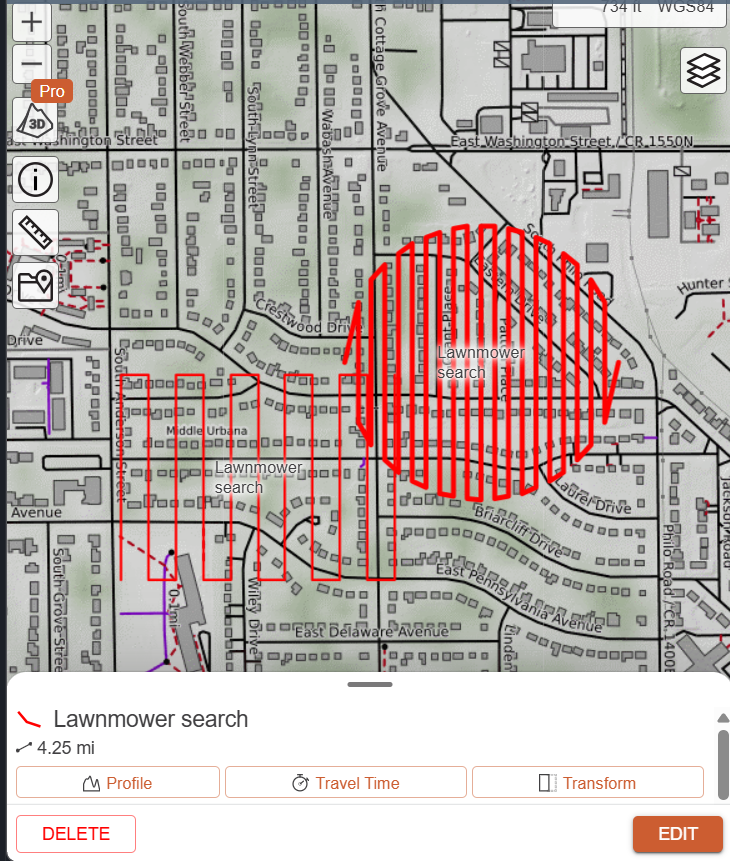

# SAR Search Planner

Generates a lawnmower search route over a circular area and exports it as a GPX file for CalTopo or a drone ground station.

## What it does:
Given a center point, search radius, lane spacing, and drone speed, it outputs a zigzag route covering the circle. It also reports area, waypoint count, path length, and estimated flight time.

## Run:
```
python search_v2.py
```

Prompts:
- Search latitude / longitude (circle center)
- Search radius (m)
- Lane spacing (m): the distance between lanes, i.e. camera swath x (1 - overlap)
- Drone speed (m/s)

Output: 'search_route.gpx'. Import it into CalTopo

Example (radius 200m, spacing 20m): 42 waypoints, 12.6 ha, 6,835 m, ~11.4 min @ 10m/s.

## Screenshot


## Why
Built while researching drone search and rescue with local responders. Planning a search pattern by hand is slow, so this makes it a few seconds. The next step is a person detector for aerial imagery.

## Limits 
- Flat-earth approx. (fine for areas under a few km)
- No wind, battery or terrain handling.
